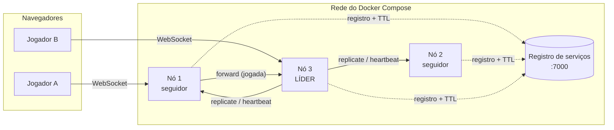

# Arquitetura e decisões de projeto

Base para o relatório (4–6 páginas) e para o slide de arquitetura.

## 1. Visão geral

Mesa de Texas Hold'em No-Limit (2 a 6 jogadores) mantida por um cluster de 6 nós iguais (no diagrama, 3 para simplificar).
Um deles é o **líder**, que aplica as jogadas; os outros guardam réplicas do estado e
assumem se o líder cair. Os jogadores usam o navegador e podem estar conectados em qualquer nó.

| Componente | Tecnologia | Responsabilidade |
|---|---|---|
| Registro (`server/src/registry.ts`) | Node + Express | Lista de nós vivos com TTL (descoberta de serviços) |
| Nó (`server/src/main.ts`) | Node + Express + ws | Eleição, heartbeat, replicação, API para os navegadores, serve o front |
| Motor do jogo (`server/src/poker/`) | TypeScript puro | Regras do poker; não sabe que existe rede |
| Front-end (`web/`) | React + Vite + Tailwind CSS | Mesa, ações, painel do cluster, failover do cliente |

Todos os nós rodam o mesmo código; só mudam `NODE_ID` e a porta publicada.

## 2. Comunicação

- **Nó ↔ nó:** HTTP/JSON (REST). É simples de depurar com `curl` e cada mensagem é uma requisição com timeout de 1 s.
- **Navegador ↔ nó:** WebSocket, porque o servidor precisa empurrar o estado da mesa a cada jogada.
- Todas as mensagens estão em [PROTOCOLO.md](PROTOCOLO.md) e tipadas em `server/src/protocol.ts`.
  O front importa esse mesmo arquivo, então cliente e servidor não divergem no formato.

## 3. Descoberta de serviços

Nenhum IP fica fixo no código. O único nome conhecido é o do registro (`REGISTRY_URL=http://registry:7000`,
resolvido pelo DNS do Compose).

1. Ao subir, cada nó descobre o próprio IP na rede do Docker (`os.networkInterfaces()`).
2. A cada 2 s ele faz `POST /register` (registro + renovação). O registro devolve os nós vivos.
3. Quem não renova em 6 s sai da lista (soft state).

**E se o registro cair?** Os nós continuam usando a última lista conhecida. O jogo segue; só não
se aprende sobre nós novos. É um ponto único de falha *apenas para a descoberta*, não para o jogo.
(Melhoria possível: replicar o registro ou usar gossip entre os nós.)

## 4. Eleição de líder: Bully + heartbeat

Arquivo: `server/src/election.ts`.

- Quem desconfia que o líder caiu manda `ELECTION` para os nós de id maior.
  - Ninguém responde → passa para a votação (abaixo) e, se ganhar, manda `COORDINATOR` para todos.
  - Alguém responde `OK` → espera o `COORDINATOR` por 4 s; se não chegar, recomeça.
- Quem recebe `ELECTION` de um id menor responde `OK` e começa a própria eleição.
- Um nó que recebe heartbeat de um líder de id menor também começa uma eleição (assim o maior id sempre volta a liderar).
- **Heartbeat:** o líder manda a cada 1 s; 3,5 s sem heartbeat = líder considerado morto.
- **O líder também vigia o quórum:** se passa 3,5 s sem resposta de um quórum (contando ele mesmo), deixa a liderança
  sozinho e entra em eleição, que só vence com votos. É o que acontece com um líder isolado por uma partição.
- **Termo (term):** cresce a cada candidatura. Mensagens de termo antigo são recusadas, e um ex-líder
  que recebe uma resposta com termo maior deixa a liderança.

**Votação antes de assumir (a mesma ideia do Raft).** O Bully decide *quem* tenta assumir, mas não garante
duas coisas: que o nó tem o estado mais novo e que ele não está isolado por uma partição. Por isso o
candidato sobe o próprio termo e pede votos a todos (`/internal/vote`). Quem vota:

1. só vota em um termo **maior** que o seu;
2. passa a usar esse termo e recusa, dali em diante, heartbeats e réplicas de termos menores (inclusive do líder antigo);
3. devolve o próprio estado.

O candidato só vira líder com votos de `WRITE_QUORUM` nós (4 de 6, contando ele) e adota o estado de maior
`seq` entre quem votou. Um nó isolado nunca consegue esses votos, então nunca vira líder sozinho.

**Por que Bully e não Ring?** Com 6 nós a diferença no número de mensagens é irrelevante, e o Bully é
mais fácil de explicar e de demonstrar: o resultado é sempre "o maior id vivo". Também temos detecção
de falha por timeout direto, sem precisar manter um anel.

**Por que a votação foi acrescentada.** Na primeira versão o vencedor só consultava os vivos, sem exigir maioria.
Num teste de partição no Docker, um nó isolado se declarou líder com um termo maior; quando a rede voltou,
os outros o aceitaram e o estado antigo dele substituiu as jogadas confirmadas durante a partição.
Com a votação, o mesmo teste termina sem perda (seção 10).

## 5. Ordenação e coordenação: Lamport + exclusão mútua no líder

- **Relógio de Lamport** (`server/src/lamport.ts`) em todas as mensagens entre nós. Cada jogada confirmada
  recebe o carimbo do líder, que aparece no histórico da mesa (`L123·n3`) e no painel.
  Se A causou B (ex.: o seguidor encaminhou a jogada e o líder a confirmou), então `L(A) < L(B)`.
- **Ordem total das jogadas:** o líder funciona como sequenciador. Os comandos passam por um mutex
  (`server/src/mutex.ts`, exclusão mútua sobre a mesa) e são aplicados um de cada vez, recebendo um
  `seq` crescente. Assim todas as réplicas veem as jogadas na mesma ordem.
- **Por que precisa de mutex se o Node tem uma thread só?** Porque `commit()` faz `await` enquanto replica.
  Sem o mutex, uma segunda jogada poderia começar no meio da primeira e as duas usariam o mesmo `seq`.
- O tempo do jogo (início da próxima mão, estouro do tempo de 30 s) também é decidido só pelo líder,
  como um comando `tick` que passa pelo mesmo caminho e também é replicado.

## 6. Replicação e consistência

Arquivo: `server/src/replication.ts`. Modelo **primário-backup com quórum de escrita**.

1. O jogador manda a jogada a qualquer nó; se não for o líder, o nó encaminha (`/internal/forward`).
2. O líder aplica a jogada numa **cópia** do estado (o motor valida as regras).
3. O líder envia o estado novo inteiro para todos (`/internal/replicate`).
4. Com `WRITE_QUORUM` confirmações (padrão: maioria, 4 de 6, contando o líder), a jogada é efetivada e respondida.
   Sem quórum, a cópia é descartada e o jogador recebe "Sem quórum".

**Por que replicar o estado inteiro (snapshot) e não só a jogada?** O estado tem poucos KB. Com snapshot,
um nó atrasado (que caiu e voltou) se atualiza com uma única mensagem, e não precisamos de log nem de replay.

**Por que o baralho fica no estado?** Para o novo líder continuar a mão com as mesmas cartas.
Se cada líder embaralhasse por conta própria, a mesa "mudaria" depois de uma falha.

**Garantia:** toda jogada confirmada está em pelo menos 4 de 6 nós, e um novo líder precisa dos votos de 4 de 6.
Dois grupos de 4 entre 6 nós sempre têm um nó em comum, então algum eleitor tem cada jogada confirmada, e o
novo líder adota o maior `seq` entre os eleitores. Além disso, quem votou já recusa o líder antigo, então ele
não consegue confirmar mais nada no termo velho. Nenhuma jogada confirmada se perde, nem em queda nem em
partição. É o argumento de interseção de quóruns do Raft/Paxos (regra geral: quórum de eleição + quórum de
escrita > número de nós; aqui os dois são `WRITE_QUORUM`).

**Leituras:** cada nó serve aos seus navegadores a própria réplica. Um seguidor pode ficar alguns
milissegundos atrás do líder (consistência eventual na leitura), o que é aceitável para mostrar a mesa.
As escritas são sempre linearizadas pelo líder.

## 7. CAP

Em uma partição de rede não dá para ter consistência (C) e disponibilidade (A) ao mesmo tempo.
Escolhemos **CP** para as escritas:

- Com 4 ou mais de 6 nós de pé, o sistema continua normalmente (aguenta 2 quedas).
- Com 3 ou menos (ou do lado minoritário de uma partição), não há votos suficientes, ninguém vira líder e
  **recusa jogadas**. A mesa congela em vez de divergir. Quando a rede volta, ele se atualiza com o lado majoritário.
- Num jogo com dinheiro (fichas), aceitar jogadas dos dois lados de uma partição duplicaria fichas
  ou daria resultados diferentes para a mesma mão. Ficar indisponível é melhor que ficar inconsistente.
- `WRITE_QUORUM=1` transforma o sistema em AP: um nó sozinho pode liderar e aceitar jogadas, mas jogadas
  podem se perder ou divergir. Isso é útil para demonstrar a diferença. (O ponto extra do enunciado pede
  quórum de leitura **e** de escrita; só o de escrita está implementado.)

## 8. Falhas tratadas

| Falha | O que acontece | Tempo típico |
|---|---|---|
| Líder cai | Seguidores ficam sem heartbeat → Bully → nó de maior id vivo assume com o estado mais recente | ~4–5 s |
| Seguidor cai | Líder registra "não respondeu"; com até 2 nós fora ainda há quórum (4 de 6) | imediato |
| Nó do navegador cai | Cliente reconecta em outro nó e manda `resume` | ~1–2 s |
| Nó volta | Bully: se tiver o maior id, pede votos, adota o estado mais novo e assume; senão vira seguidor e recebe snapshot | ~2–5 s |
| Nó trava sem cair (`docker pause`) | Para de responder heartbeat → tratado como queda; termo maior impede que ele volte achando que é líder | ~4 s |
| Partição de rede (1 nó isolado) | O lado com 5 nós segue jogando (elege um líder se preciso). O nó isolado não consegue votos e não aceita jogadas; se ele era o líder, deixa a liderança em ~4 s por falta de quórum. Quando a rede volta, ele força uma nova eleição e é atualizado pelo lado majoritário | ~4 s para cada lado |
| Registro cai | Nós usam a lista em cache; jogo continua | — |
| 3 de 6 nós caem (ou partição 3 + 3) | Nenhum lado tem 4 votos: ninguém lidera e as jogadas são recusadas, estado preservado | — |
| Jogador não age | Líder dá check/fold automático após 30 s | 30 s |

## 9. Limitações conhecidas (bom para a parte de "trade-offs" do relatório)

- **Escrita sem quórum que chegou em alguns nós:** se o líder enviar uma jogada, um seguidor guardar e o
  líder cair antes de juntar o quórum, essa jogada pode "aparecer" depois da eleição. Não perde jogada
  confirmada, mas pode efetivar uma que o cliente recebeu como erro. Resolver exigiria duas fases (prepare/commit).
- **Relógios físicos:** os prazos (30 s por jogada) usam o relógio do líder. Num mesmo host o desvio é desprezível.
- **Número par de nós:** 6 nós aguentam 2 quedas, o mesmo que 5, e uma partição 3 + 3 para o jogo inteiro.
  Mantivemos 6 por escolha do grupo; com 5 ou 7 o quórum fica mais eficiente.
- **Tudo em memória:** se todos os nós caírem juntos, a partida se perde. Dá para persistir o snapshot em volume.
- **Registro único:** ponto único de falha para a descoberta (não para o jogo).
- **Regra simplificada:** um all-in que aumenta menos que o mínimo reabre a ação (no poker oficial, não reabre).

## 10. Como foi testado

O teste automático de failover usa um cluster próprio de 3 nós; os testes de partição abaixo também foram
feitos com 3 nós. Com 6 nós no Docker foram conferidos: eleição do nó 6, quedas sucessivas dos nós 6 e 5 (o 5 e
depois o 4 assumem), falta de quórum com 3 nós fora e volta do nó 6 à liderança.

- `npm run test:failover`: teste de ponta a ponta com processos reais:
  eleição inicial → 2 bots jogando → derruba o líder → verifica novo líder, termo maior, `seq` preservado,
  bot migrado de nó e jogo continuando com as fichas conservadas → religa o nó 3 e verifica que ele reassume
  sincronizado → derruba os 2 seguidores e verifica que o líder, sozinho, deixa a liderança (~4 s), não consegue
  votos para voltar e recusa escritas.
- **Partição no Docker** (manual, com `docker network disconnect` e `connect`; comandos no README), com dois bots jogando:

  | Caso | Durante a partição | Depois de religar a rede |
  |---|---|---|
  | Seguidor (nó 1) isolado | Nós 2 e 3 seguem com o nó 3 líder: seq 12 → 49 | Nó 1 volta atualizado; seq continua (58), nada perdido |
  | Líder (nó 3) isolado | Nó 3 deixa a liderança por falta de quórum (seq parada em 12); nós 1 e 2 elegem o nó 2 (termo 3) e seguem | Nó 3 recebe o estado nos votos e reassume (termo 9); seq continua (59), nada perdido |

  Antes da votação, o primeiro caso terminava com o nó isolado como líder e o cluster de volta ao seq 26: as jogadas da partição se perdiam.

## 11. Roteiro da demonstração (8 min)

1. **Slide de arquitetura** (diagrama acima): 1 min.
2. `docker compose up` já rodando. Abrir `localhost:8001` e `localhost:8006` em duas janelas
   (uma anônima), sentar com dois nomes. Abrir `localhost:8002/dashboard` (o nó 2 redireciona para o painel do líder). Opcional: `npm run bot -- --url http://localhost:8002 --count 2`.
3. Jogar uma mão e mostrar no histórico os carimbos de Lamport e o nó que confirmou (`n6`).
4. **Derrubar o líder no meio de uma mão:** `docker compose kill node6`.
   - Painel: nó 6 FORA DO AR; eventos de ELECTION/OK/COORDINATOR; nó 5 vira líder com termo maior, e o painel
     muda sozinho para o endereço do nó 5.
   - A janela que estava no 8006 mostra "reconectando" e volta sozinha em outro nó, com as mesmas cartas.
   - A mão continua do mesmo ponto (mesmo board, mesmo pote).
5. **Religar:** `docker compose start node6` → ele sincroniza e reassume (Bully).
6. **CAP:** `docker compose kill node4 node5 node6` → tentar jogar → "Sem líder". Religar com `docker compose start node4 node5 node6`.
7. Perguntas: 4 min.

## 12. Sugestão de divisão (4 integrantes)

| Pessoa | Parte | Arquivos |
|---|---|---|
| 1 | Estrutura do projeto, descoberta, nó do cluster, Docker | `config.ts`, `registry.ts`, `discovery.ts`, `node.ts`, `main.ts`, `Dockerfile`, `docker-compose.yml` |
| 2 | Motor do poker, mesa no navegador, README e arquitetura | `server/src/poker/*`, `web/src/App.tsx`, componentes da mesa |
| 3 | Lamport, protocolo, eleição Bully, painel, scripts de teste | `lamport.ts`, `rpc.ts`, `protocol.ts`, `election.ts`, `ClusterBar.tsx`, `Dashboard.tsx`, `server/scripts/*` |
| 4 | Projeto web, replicação com quórum, WebSocket e failover | `mutex.ts`, `replication.ts`, `clients.ts`, `web/src/useTable.ts`, `docs/PROTOCOLO.md` |

Todo mundo precisa conseguir explicar o fluxo de uma jogada (seção 6) e o que acontece quando o líder cai (seções 4 e 8).

## Uso de IA

O enunciado exige declarar no relatório como ferramentas de IA foram usadas. A versão inicial deste
código foi gerada com o Claude (Anthropic) a partir do enunciado. Descrevam isso no relatório, junto com
o que o grupo revisou, alterou e testou.
